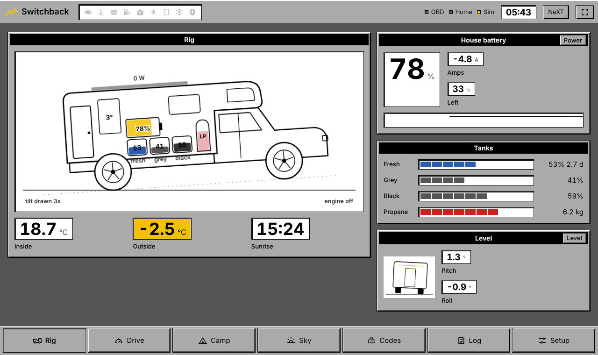
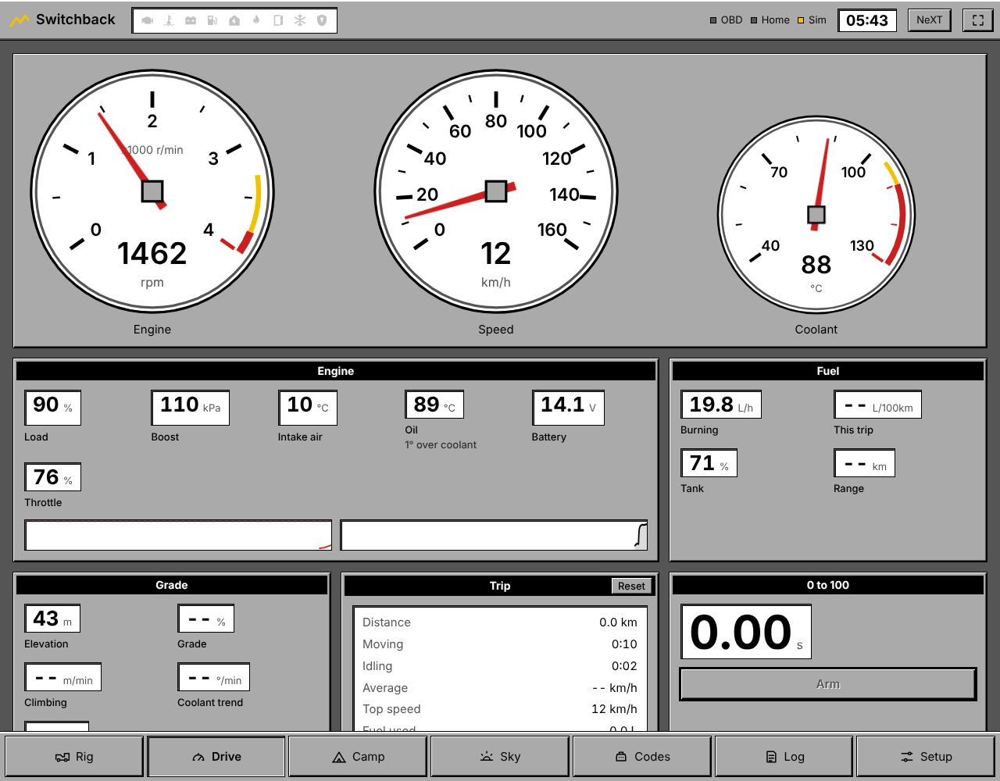

# Switchback

Dashboard for my truck and slide in camper. Runs on a 7" screen in the camper off a Pi, and on my phone in the cab.

- **Truck** comes in over a cheap ELM327 (Bluetooth LE or a serial/USB one) straight from the browser
- **Camper** is an ESP32 with a pile of sensors posting to the Pi
- **Homebase** (the Pi) relays everything to every screen, logs it all to disk, and pings my phone through ntfy if something goes wrong while I'm away

**Live demo:** [tristedw.ca/switchback](https://tristedw.ca/switchback/) runs on the built in simulator since there's no truck attached to the internet.



## What it does

**Rig** is the home screen. Side view of the truck and camper that actually tilts with the accelerometer, tank levels fill, door goes red when it's open, solar strip lights up, wheels spin when moving.

**Drive** has a tach, speedo and coolant gauge, load/boost/IAT/oil/battery, live fuel burn and trip economy, range left in the tank, fuel trims on gas trucks, a 0 to 100 timer, and a grade panel for the Coquihalla: elevation, climb rate, grade, coolant trend and minutes until it hits the warning line at the current rate.

**Camp** covers the house bank (SOC, volts, amps, hours left or to full), a clear sky solar estimate for the day, a bubble level with side and rear views plus a zero button, climate, fridge, furnace, propane by weight, and camp guard.

**Sky** shows a sun arc for today, first light through proper dark, day length vs yesterday, moon phase, a barometer with a 3 hour trend, pressure altitude and what water boils at up here.

**Codes** reads stored and pending DTCs, MIL status, and clears them with a confirm step.

**Log** has a timeline of alarms, trips, motion at night and connection changes, CSV recording and replay of any session, a service tracker off the odometer, and past trips.

### Warning lights

The strip up top is a cluster style idiot light row: check engine, coolant, charging, low fuel, house power, propane, door, freeze, guard. Yellow for warnings, red and blinking for the ones that need you now.

Alarms that run all the time:

| | trips when |
|---|---|
| Coolant | over the warn / crit temps, with hysteresis |
| Oil over coolant | oil runs more than 8°C over coolant for a minute on the diesel. classic 6.0 oil cooler symptom |
| Not charging | engine running and battery under 13.0 V |
| House battery | low SOC |
| Fridge | warm for 10 min, or door open 90 s |
| Freeze | outside near freezing |
| Propane | MQ-2 over the trip point. the ESP32 also has its own buzzer for this |
| Tanks | black nearly full, fresh low, low fuel |
| Camp guard | door or motion while armed, 30 s grace after arming |
| Pressure falling | 3 hPa drop over 3 hours |
| Quiet hours | idling at camp after 10pm |

Crit alarms klaxon until acknowledged and get read out with speech synthesis. Everything can be snoozed. Thresholds live in Setup.

### Other bits

- NeXTSTEP style by default, a System 7 theme for sun glare, and a red only night theme so you keep your night vision. auto switches to night after dark
- runs offline as a PWA, keeps the screen awake
- metric or imperial
- vehicle profiles for my F250 6.0 and the Tahoe 5.3
- keyboard: 1 to 7 switch screens, Esc acks everything
- sim has scenarios (Coquihalla grade, stuck thermostat, night at camp...), time warp, and buttons to fake a gas leak, door open, motion, etc



## Layout

```
web/        React + TS + Vite dashboard
homebase/   node server for the Pi, ws relay + jsonl logs + ntfy alerts
firmware/   ESP32 camper node, PlatformIO
docs/       wiring and the key list
```

## Running it

```sh
cd web && npm i && npm run dev        # sim mode on localhost:5173
npm test                              # elm parsing, dtc decode, sun math
```

Homebase on the Pi:

```sh
cd web && npm i && npm run build
cd ../homebase && npm i && node server.js
# then open http://<pi>:8787
```

`homebase/deploy/` has a systemd unit and a kiosk script for Chromium. `node tools/fake-esp.js` pretends to be the ESP32 if you want to test the Pi end without hardware.

Firmware: copy `firmware/esp32-camper/include/config.example.h` to `config.h`, set wifi and calibration, `pio run -t upload`. Pinout is in [docs/wiring.md](docs/wiring.md).

## OBD notes

- Web Bluetooth and Web Serial are Chrome/Edge only. On the Pi I run Chromium with the Web Bluetooth flag
- BLE adapters all use different services. it tries FFF0, FFE0, 18F0 and the Vgate one, then picks characteristics by their notify/write properties
- classic Bluetooth SPP adapters pair as a serial port, so those go through the serial option (most are 38400 baud)
- only PIDs in the ECU's supported bitmap get polled
- diesels need PID 5E for economy. MAF math doesn't work when the air fuel ratio swings that much
- the 1981 K20 has no OBD port at all. that one gets its own ESP32 sender board eventually

## License

MIT
